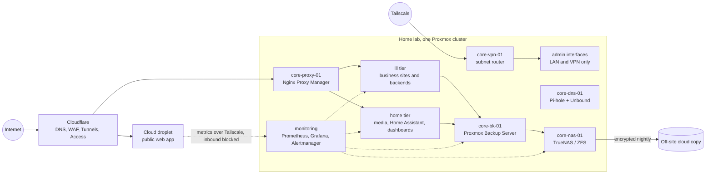

# homelab

A three-node Proxmox homelab that runs a small business's production websites alongside a household's services, built and operated like a small company's infrastructure: tiered, documented, backed up with proof, monitored, and changed through a written process.

This repo is the public overview. The working repos (stack files, infrastructure snapshots, the automation server) are private because they are a map of a real network.

**Evan Longar.** Associate SysAdmin by day (Windows Server, Hyper-V, Active Directory, Fortinet, Ubiquiti, Wazuh, CMMC Level 2). This lab is where I practice the same disciplines on Linux and open-source tooling.

---

## At a glance

| | |
|---|---|
| Hypervisors | 3-node Proxmox VE cluster (Intel i5, AMD Ryzen 5 with two passthrough GPUs, Intel Xeon) |
| Storage | TrueNAS SCALE VM with six passed-through SSDs (raidz1 plus mirror), ZFS snapshots |
| Backups | Proxmox Backup Server with per-tier namespaces, encrypted off-site copy, alerts on failure, tested restores |
| Workloads | About 60 Docker containers and 10 VMs/LXCs across three tiers |
| Edge | Nginx Proxy Manager, Cloudflare (DNS, Tunnels, Access, R2), Tailscale |
| DNS | Pi-hole with Unbound, split-horizon internal zone |
| Monitoring | Prometheus, Alertmanager, Grafana, Uptime Kuma, push alerts to phone and email |
| Cloud | One DigitalOcean droplet for a public web app, Cloudflare-only ingress |
| Operations | Every change explained, backed up, verified and logged; AI-assisted through a self-built MCP server with guardrails |

## Architecture

## Design decisions

### Four tiers, one number each

Everything (every VM, container, backup, repo and DNS name) belongs to one tier, and the tier number drives the rest so it is easy to remember.

| # | Tier | Rule of thumb | VLAN (planned) | VMID range |
|---|---|---|---|---|
| 1 | core | Both the business and the house break if it dies | 10 | 1xx |
| 2 | lll | A customer or the business site breaks | 20 | 2xx |
| 3 | home | Only the house notices | 30 | 3xx |
| 4 | iot | Untrusted devices, nothing of mine runs here | 40 | n/a |

Hostnames are `<tier>-<role>-<nn>` (`core-dns-01`, `home-ha-01`). Compose stacks live at `/opt/stacks/<tier>-<app>/` with `tier` and `env` labels. Backups use the tier as their namespace. Repos are split by product and tier. The rule for ambiguous cases is one question: *who breaks if this dies?*

### Backups with proof, not just backups

- **Images:** Proxmox Backup Server, one namespace per tier, retention set by data class (business data kept longer and more often than media configs).
- **Files and databases:** application data, including live SQLite copies taken with the online backup API so production never pauses, sent to PBS nightly or weekly.
- **Immutability:** daily ZFS snapshots under the backup datastore, so a compromised client that can write to the share still cannot delete history.
- **Off-site:** an encrypted nightly copy, sized to a fixed cloud budget with a metric that alerts before it is exceeded.
- **Alerting on absence:** every job writes a success timestamp; Prometheus alerts when one is stale *or zero*. A bug that dropped zero-valued timestamps once hid 39 failed nights; finding and fixing it is in the lessons below.
- **Restore tests:** an LXC restored to a throwaway ID, and the business database restored byte for byte against its source checksum. A full verify job runs weekly.

### Nothing admin-facing on the internet

- Only ports 80 and 443 are forwarded, to the reverse proxy. Admin interfaces (hypervisor, NAS, proxy, Docker UI, monitoring) answer only the LAN and the VPN, enforced by an access list and split-horizon DNS so they also work from inside.
- Business sites accept traffic only from Cloudflare's ranges and the LAN, so the origin cannot be reached around the CDN.
- The VPN uses a least-privilege policy with built-in tests that must pass before it saves. The cloud server is tagged so it cannot open any connection into the home network, while monitoring from home still reaches it.
- Services that never needed the network were closed (an unauthenticated Docker remote API, an MQTT broker now reachable only by its one real client, unused listeners on the backup server).
- Secrets never go in git. Repos are secret-scanned, and one dead token found in history was proven inactive and scrubbed from every commit.

### Change management

Every change follows the same steps, whether it is a firewall rule or a container update:

1. **Explain first:** what, why, what could break, how to roll back, in one plain paragraph.
2. **Back up first,** and name the backup in the change record.
3. **Dev before prod** for anything in the business tier, through pull requests.
4. **Verify after,** with evidence (a port scan, a log line, a Grafana panel, a browser check), not "the command ran".
5. **Record it:** a dated changelog with every backup file name and rollback command.

Production deploys of the business site go through a server-side two-person gate: **[two-person-deploy-gate](https://github.com/longarevan13/two-person-deploy-gate)**. It refuses any release that is not a reviewed, approved merge into `main` by someone other than the author, verifies checksums, health-checks and rolls back automatically. It has a 27-check test suite against a mock GitHub API.

### AI-assisted operations, with guardrails

I run the lab with Claude as an operator through **proxmox-mcp**, a Node.js [Model Context Protocol](https://modelcontextprotocol.io) server I maintain (about 90 tools across Proxmox, Docker, TrueNAS, Pi-hole, Home Assistant, backups and GitHub). The guardrails are the interesting part:

- A written rulebook: explain before changing, back up first, ask before anything in production, DNS, firewall or anything irreversible, verify after.
- The server only answers an allow-list of clients, its self-backup can only write one repo after a secret scan, and the household dashboard's own "fix it" button goes through a separate least-privilege service with four allow-listed actions and unit tests.
- Credentials are always entered by me, never by the assistant.
- Every completed task is logged with the evidence and mapped to the equivalent work in my day job.

## Lessons learned (selected incidents)

| What happened | Root cause | Fix |
|---|---|---|
| Business backups "failed" for 39 nights with no alert | A stale rollback container exposed a known-bad dev database under a second name, flipping the run's verdict; the alert rule filtered out zero timestamps | Documented exception, wrapper that logs its real verdict and exits non-zero, alert rule fixed and proven with a forced failure |
| Backups landed on the host they protect for 7 weeks | NFS mount timed out at boot; the backup folder silently became a local directory | Mount hardened, Docker ordered after remote filesystems, "metrics missing" alert added |
| Every admin panel answered from the internet | Reverse proxy matched on Host header, no access list | LAN-and-VPN access list on every admin host, split-horizon DNS, verified from outside |
| Unauthenticated Docker remote API on the LAN | A leftover systemd drop-in | Listener removed with live-restore so 46 containers stayed up |
| Docker host disk at 97% during a build night | Image tags from frequent dashboard builds, unbounded logs | Cleanup with a keep-list, log caps, journal cap, weekly prune timer with its own metric |

## Mapping to the day job

| Lab practice | Work equivalent | Framework |
|---|---|---|
| Per-tier PBS jobs, retention by data class, restore tests | Unitrends job design and restore testing | NIST 800-171 3.8.9 |
| Admin interfaces LAN/VPN only, CDN-only origins | Restricting management interfaces to admin networks | 3.13.1, 3.4.7 |
| Least-privilege VPN policy with tests | VPN and firewall policy changes with a test plan | 3.1.5 |
| Dated changelog with backups and rollback | Change control for production servers | 3.4.3 |
| Live inventory reconciled against docs | Asset inventory and SSP evidence | 3.4.1 |
| Patching with snapshots and automatic rollback | Monthly patch windows | 3.14.1 |

## Roadmap

- Separate the business tier onto its own Docker host, then VLANs per tier.
- Off-site copy of current VM images from the backup server.
- Login hardening across every admin interface.
- A home Wazuh deployment mirroring the one I run at work.
- A per-service runbook for everything in the core tier.

## Contact

GitHub: [@longarevan13](https://github.com/longarevan13). Business: [litlittlelab.com](https://litlittlelab.com).
